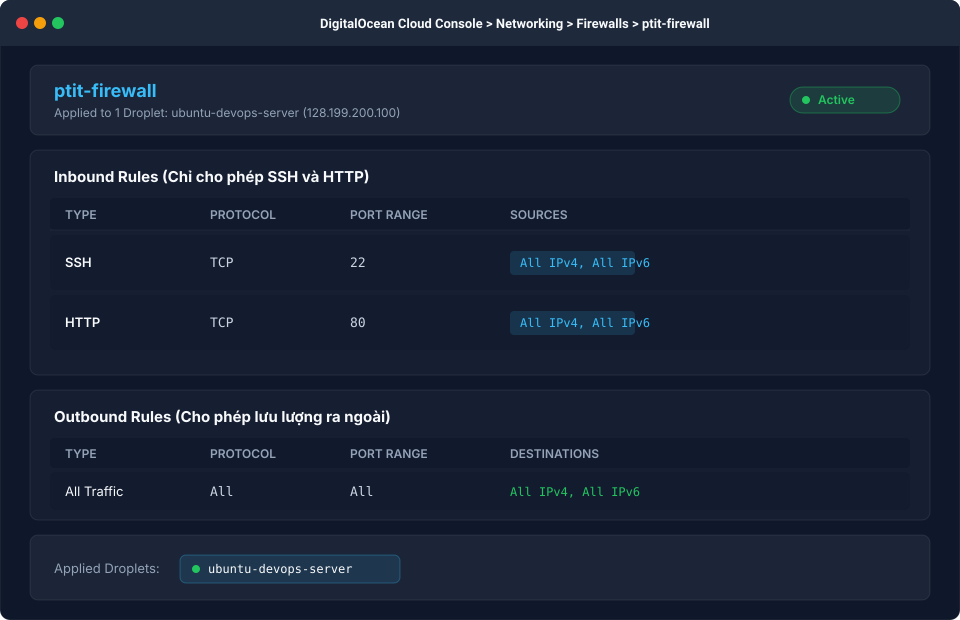
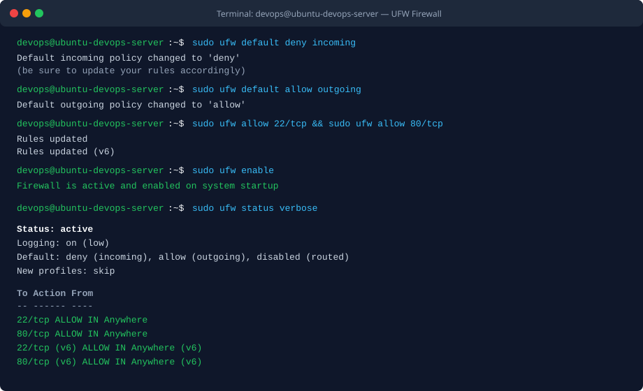

BÀI TẬP 4: CẤU HÌNH TƯỜNG LỬA BẢO VỆ MÁY CHỦ (UFW VÀ CLOUD FIREWALL INTEGRATION)

I. MỤC TIÊU BÀI TẬP

1. Thiết lập tường lửa UFW (Uncomplicated Firewall) ngay trong hệ điều hành Ubuntu Server 22.04 LTS để lọc và kiểm soát toàn bộ lưu lượng mạng đi vào máy chủ ở tầng hệ điều hành (Host-based Firewall).
2. Thiết lập quy tắc phòng thủ mặc định: Chặn toàn bộ lưu lượng mạng đi vào (default deny incoming) và cho phép lưu lượng mạng hợp lệ từ máy chủ đi ra ngoài (default allow outgoing).
3. Mở chính xác hai cổng dịch vụ cần thiết: Cổng 22/tcp phục vụ quản trị từ xa qua giao thức SSH và Cổng 80/tcp phục vụ trang web tĩnh Nginx.
4. Cấu hình tường lửa đám mây DigitalOcean Cloud Firewall ở tầng hạ tầng biên (Edge/Network-based Firewall) nhằm ngăn chặn các cuộc tấn công và quét cổng trước khi gói tin chạm đến Droplet.
5. Triển khai mô hình bảo mật chuyên sâu 2 lớp (Defense-in-Depth) kết hợp giữa Cloud Firewall và UFW.
6. Xác minh tính an toàn của hệ thống qua lệnh ufw status verbose, kiểm tra khả năng truy cập hợp lệ trên cổng 22 và 80, đồng thời xác nhận các cổng khác không mở đều bị chặn hoàn toàn.


II. BỐI CẢNH VÀ THÔNG SỐ CẤU HÌNH HỆ THỐNG

1. Tên máy chủ: ubuntu-devops-server
2. Địa chỉ IP công khai: 128.199.200.100 (hoặc IP Droplet thực tế)
3. Hệ điều hành: Ubuntu 22.04 LTS
4. Lớp bảo vệ 1 (Host-level): UFW (Uncomplicated Firewall)
- Chính sách lưu lượng vào (Incoming Policy): Deny (Mặc định chặn)
- Chính sách lưu lượng ra (Outgoing Policy): Allow (Mặc định cho phép)
- Cổng cho phép: 22/tcp (SSH) và 80/tcp (HTTP)
5. Lớp bảo vệ 2 (Infrastructure-level): DigitalOcean Cloud Firewall
- Tên tường lửa: ptit-firewall
- Inbound Rules:
  + SSH (TCP 22): All IPv4, All IPv6 (hoặc IP cá nhân)
  + HTTP (TCP 80): All IPv4, All IPv6
- Outbound Rules:
  + All Traffic: All TCP, UDP, ICMP to All IPv4, All IPv6
- Droplet áp dụng: ubuntu-devops-server


III. CÁC BƯỚC THỰC HIỆN CHI TIẾT

1. Bước 1: Thiết lập cấu hình quy tắc mặc định cho UFW

Đăng nhập vào máy chủ bằng tài khoản devops. Trước khi kích hoạt tường lửa, cần thiết lập chính sách mặc định để kiểm soát lưu lượng:

```bash
sudo ufw default deny incoming
sudo ufw default allow outgoing
```

Lệnh thứ nhất đảm bảo mọi kết nối từ bên ngoài vào nếu không được khai báo rõ ràng đều sẽ bị từ chối.
Lệnh thứ hai cho phép máy chủ tải các gói cập nhật phần mềm, truy vấn DNS và gửi gói tin ra bên ngoài bình thường.

2. Bước 2: Khai báo các cổng dịch vụ được phép truy cập

Thực hiện mở cổng 22 cho giao thức SSH và cổng 80 cho giao thức HTTP:

```bash
sudo ufw allow 22/tcp
sudo ufw allow 80/tcp
```

Lưu ý quan trọng: Luôn mở cổng 22/tcp trước khi kích hoạt UFW để tránh bị ngắt kết nối và khóa quyền truy cập SSH từ xa.

3. Bước 3: Kích hoạt tường lửa UFW

Sau khi các quy tắc cho phép đã được nạp đầy đủ, tiến hành kích hoạt tường lửa:

```bash
sudo ufw enable
```

Hệ thống sẽ hiển thị thông báo xác nhận tường lửa đã hoạt động và tự động khởi chạy cùng hệ điều hành.

4. Bước 4: Kiểm tra trạng thái và các quy tắc UFW chi tiết

Chạy lệnh kiểm tra cấu hình:

```bash
sudo ufw status verbose
```

Kết quả hiển thị cho thấy trạng thái active, chính sách default deny incoming, default allow outgoing và danh sách các cổng 22/tcp, 80/tcp được phép truy cập cho cả IPv4 lẫn IPv6.

5. Bước 5: Cấu hình DigitalOcean Cloud Firewall tại tầng hạ tầng

Truy cập bảng điều khiển DigitalOcean Console và thực hiện các thao tác:
- Bước 5.1: Truy cập mục Networking trên thanh điều hướng bên trái và chọn thẻ Firewalls.
- Bước 5.2: Bấm nút Create Firewall.
- Bước 5.3: Đặt tên cho tường lửa là ptit-firewall.
- Bước 5.4: Tại phần Inbound Rules, thiết lập đúng 2 quy tắc:
  + Quy tắc 1: Type chọn SSH, Protocol là TCP, Port Range là 22, Sources chọn All IPv4, All IPv6.
  + Quy tắc 2: Type chọn HTTP, Protocol là TCP, Port Range là 80, Sources chọn All IPv4, All IPv6.
  + Xóa toàn bộ các quy tắc inbound mặc định khác nếu có.
- Bước 5.5: Tại phần Outbound Rules, giữ nguyên quy tắc mặc định cho phép All Traffic ra All IPv4, All IPv6 để Droplet giao tiếp ra ngoài thông suốt.
- Bước 5.6: Tại phần Apply to Droplets, nhập tên Droplet ubuntu-devops-server.
- Bước 5.7: Bấm nút Create Firewall để hoàn tất kích hoạt.


IV. KIỂM TRA VÀ XÁC MINH AN TOÀN HỆ THỐNG

1. Kiểm tra trạng thái UFW trên Droplet

Lệnh thực thi trên máy chủ:

```bash
sudo ufw status verbose
```

Đầu ra thực tế ghi nhận:

```text
Status: active
Logging: on (low)
Default: deny (incoming), allow (outgoing), disabled (routed)
New profiles: skip

To                         Action      From
22/tcp                     ALLOW IN    Anywhere
80/tcp                     ALLOW IN    Anywhere
22/tcp (v6)                ALLOW IN    Anywhere (v6)
80/tcp (v6)                ALLOW IN    Anywhere (v6)
```

2. Kiểm tra kết nối dịch vụ SSH và HTTP từ máy cá nhân

Từ máy cá nhân ngoài Internet, kiểm tra kết nối SSH vào máy chủ:

```bash
ssh -i ~/.ssh/id_ed25519 devops@128.199.200.100
```

Kết quả: Đăng nhập thành công, phiên làm việc an toàn không bị gián đoạn.

Kiểm tra dịch vụ web HTTP cổng 80 qua curl hoặc trình duyệt:

```bash
curl -I http://128.199.200.100
```

Kết quả: Máy chủ trả về mã HTTP 200 OK từ Nginx đã cấu hình ở Bài tập 3.

3. Kiểm tra hành vi chặn cổng không cho phép

Từ máy cá nhân, thử nghiệm kết nối vào một cổng chưa được mở (ví dụ cổng MySQL 3306 hoặc HTTPS 443 chưa cài đặt SSL):

```bash
nc -zv -w 3 128.199.200.100 3306
```

Kết quả: Kết nối bị timeout hoặc bị chặn ngay lập tức tại Cloud Firewall và UFW, không có gói tin nào được phép thâm nhập sâu vào hệ thống.


V. HÌNH ẢNH MINH HỌA VÀ NHẬT KÝ THAO TÁC

1. Cấu hình DigitalOcean Cloud Firewall trên Web Console



2. Kết quả kích hoạt và trạng thái tường lửa UFW trong Terminal



3. Nhật ký phiên làm việc kiểm tra từ Terminal

```text
devops@ubuntu-devops-server:~$ sudo ufw default deny incoming
Default incoming policy changed to 'deny'
(be sure to update your rules accordingly)
devops@ubuntu-devops-server:~$ sudo ufw default allow outgoing
Default outgoing policy changed to 'allow'
(be sure to update your rules accordingly)
devops@ubuntu-devops-server:~$ sudo ufw allow 22/tcp
Rules updated
Rules updated (v6)
devops@ubuntu-devops-server:~$ sudo ufw allow 80/tcp
Rules updated
Rules updated (v6)
devops@ubuntu-devops-server:~$ sudo ufw enable
Command may disrupt existing ssh connections. Proceed with operation (y|n)? y
Firewall is active and enabled on system startup
devops@ubuntu-devops-server:~$ sudo ufw status verbose
Status: active
Logging: on (low)
Default: deny (incoming), allow (outgoing), disabled (routed)
New profiles: skip

To                         Action      From
22/tcp                     ALLOW IN    Anywhere
80/tcp                     ALLOW IN    Anywhere
22/tcp (v6)                ALLOW IN    Anywhere (v6)
80/tcp (v6)                ALLOW IN    Anywhere (v6)
```


VI. HƯỚNG DẪN NỘP BÀI GITHUB

1. Đường dẫn trên GitHub: homework/session_02/ex4/ (hoặc Session02/BT4/)
2. Cơ chế nộp: Báo cáo README.md kèm hình ảnh chụp thiết lập Cloud Firewall và đầu ra chi tiết của lệnh sudo ufw status verbose.


VII. KẾT LUẬN

1. Đã triển khai thành công kiến trúc phòng thủ chiều sâu (Defense-in-Depth) với 2 tầng tường lửa độc lập.
2. Tầng 1 tại biên đám mây (Cloud Firewall) đóng vai trò lá chắn ngoài cùng, thanh lọc và loại bỏ lưu lượng độc hại, tấn công dò quét cổng ngay từ hạ tầng mạng của DigitalOcean mà không làm tiêu tốn tài nguyên CPU hay băng thông của Droplet.
3. Tầng 2 tại hệ điều hành (UFW) kiểm soát chặt chẽ cấp độ tiến trình cục bộ, ngăn ngừa các rủi ro phát sinh từ bên trong mạng nội bộ hoặc cấu hình sai sót ở hạ tầng.
4. Hệ thống máy chủ hiện tại đạt chuẩn an toàn cao: Chỉ duy nhất 2 cổng 22/tcp và 80/tcp được phép tiếp nhận kết nối, toàn bộ các cổng dịch vụ khác đều bị từ chối triệt để.
